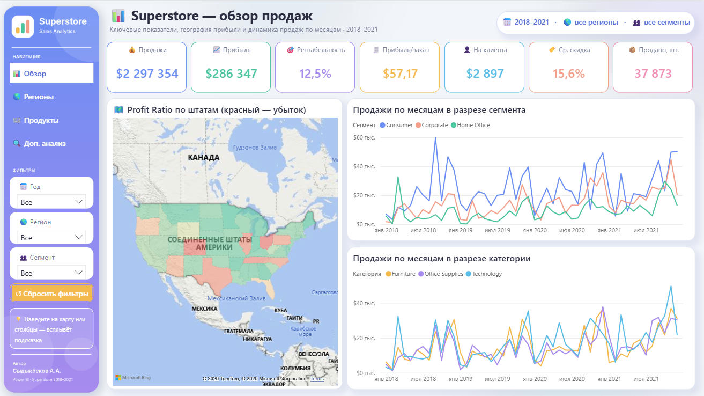
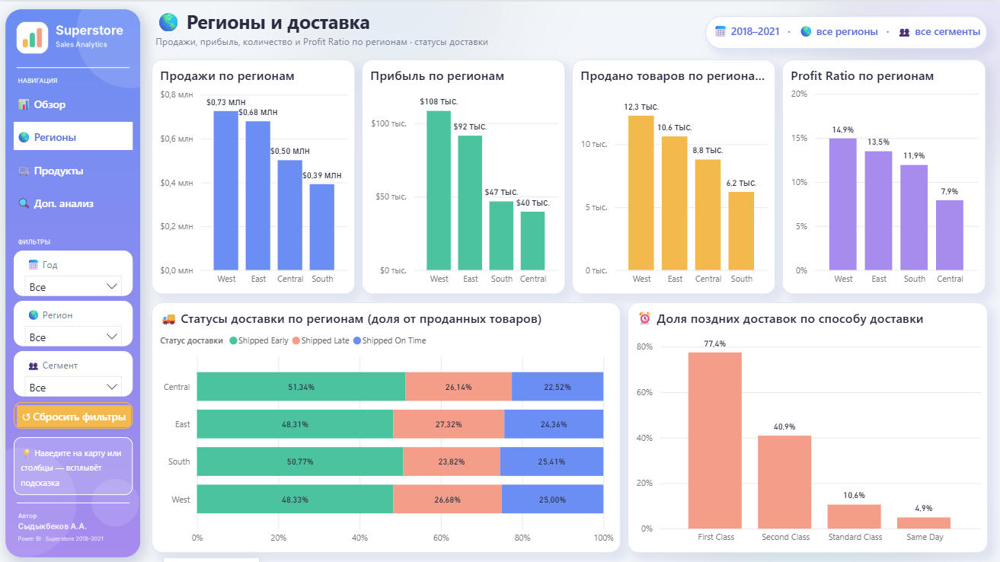
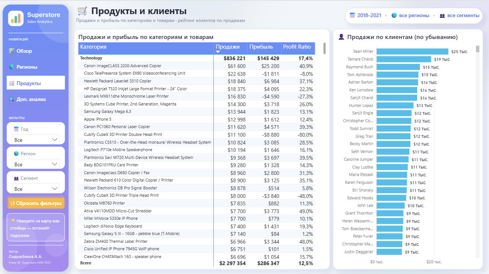
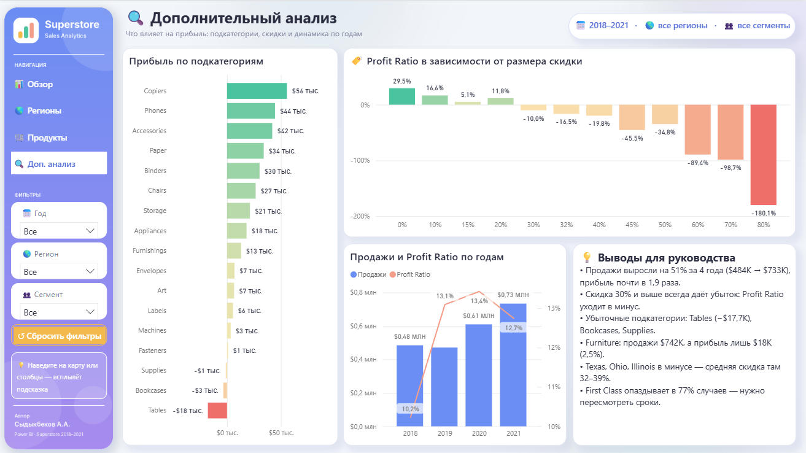

# Superstore — дашборд продаж в Power BI

Интерактивный отчёт по продажам сети Superstore (США, 2018–2021): выручка, прибыль, рентабельность, доставка, продукты и клиенты.

**Автор:** Сыдыкбеков Адиль · **Инструмент:** Power BI Desktop

📥 **Скачать отчёт:** [Superstore_Sales_Dashboard.pbix](Superstore_Sales_Dashboard.pbix) (кнопка «Download raw file» на странице файла)

## Страницы отчёта

| Страница | Что показывает |
|---|---|
| 📊 Обзор | 7 KPI-карточек, карта Profit Ratio по штатам, продажи по месяцам в разрезе сегмента и категории |
| 🌎 Регионы и доставка | продажи, прибыль, количество и Profit Ratio по регионам, статусы доставки, доля поздних доставок |
| 🛒 Продукты и клиенты | матрица «категория → товар» с продажами, прибылью и Profit Ratio, рейтинг клиентов |
| 🔍 Доп. анализ | прибыль по подкатегориям, влияние скидки на рентабельность, динамика по годам, выводы для руководства |

## Что использовано

- **Power Query:** очистка CSV (валюта в тексте, отрицательные числа в скобках, проценты, даты в формате ru-RU), колонки месяца и года
- **DAX:** меры Total Sales, Total Profit, Profit Ratio, Profit per Order, Sales per Customer, Avg Discount, Late Shipment %, динамическая подпись активных фильтров
- **Оформление:** своя тема, фоновое изображение с боковой панелью, кнопки навигации между страницами, кнопка «Сбросить фильтры», синхронизированные срезы (Год, Регион, Сегмент) на всех страницах
- **Подсказки:** страница-подсказка (tooltip) с KPI и прибылью по категориям для карты и столбчатых диаграмм
- **Условное форматирование:** красно-жёлто-зелёная шкала для карты, прибыли по подкатегориям и Profit Ratio по скидке

## Скриншоты

## Ключевые выводы

- Продажи выросли на 51% за 4 года ($484K → $733K), прибыль почти в 1,9 раза.
- Скидка 30% и выше всегда даёт убыток.
- Убыточные подкатегории: Tables, Bookcases, Supplies.
- Furniture: продажи $742K при прибыли всего $18K (2,5%).
- First Class опаздывает в 77% случаев.

> Данные: учебный датасет Sample Superstore. Чтобы обновить данные, укажите путь к своему CSV в Power Query (Главная → Преобразование данных → источник).
